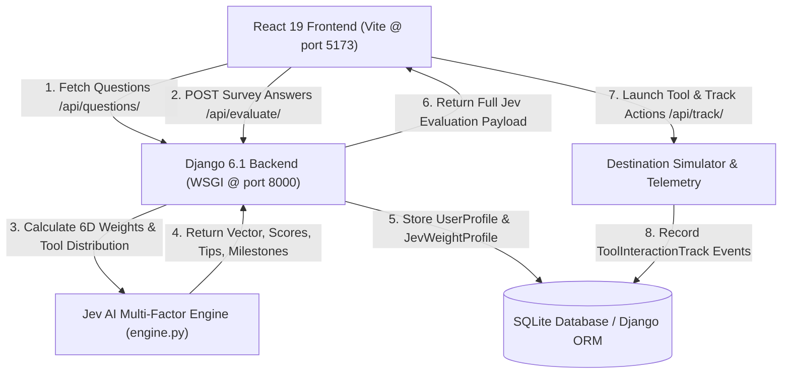
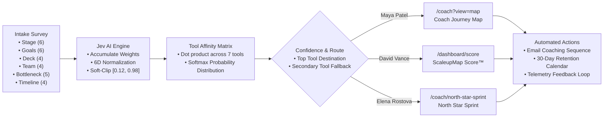

# ScaleupMap Smart Onboarding & Jev AI Decision Engine — Complete Technical Documentation

> **ScaleupMap Hackathon — Challenge 2: Smarter Onboarding**  
> *How might we use what we learn about a new user to send them to the right tool automatically?*

---

## 📑 Table of Contents

1. [Executive Overview](#1-executive-overview)
2. [Platform Reference & Design Compliance](#2-platform-reference--design-compliance)
3. [System Architecture](#3-system-architecture)
4. [Jev AI Multi-Factor Decision Engine](#4-jev-ai-multi-factor-decision-engine)
5. [Decision Logic: Flowchart, Matrix, and Code](#5-decision-logic-flowchart-matrix-and-code)
6. [Challenge 2 Requirement: Two Different Users Getting Two Different Results](#6-challenge-2-requirement-two-different-users-getting-two-different-results)
7. [Outcome Telemetry: "Tracks Whether It Worked"](#7-outcome-telemetry-tracks-whether-it-worked)
8. [Bonus Direction 1: Automated Email Coaching Sequences](#8-bonus-direction-1-automated-email-coaching-sequences)
9. [Bonus Direction 2: 30-Day Engagement & Retention Calendar](#9-bonus-direction-2-30-day-engagement--retention-calendar)
10. [Data Models & API Endpoints](#10-data-models--api-endpoints)
11. [Installation, Testing, and Verification](#11-installation-testing-and-verification)

---

## 1. Executive Overview

ScaleupMap is the venture intelligence platform for the startup ecosystem. To maximize founder activation and mitigate churn, **Challenge 2: Smarter Onboarding** tasks us with building a system that:
1. **Collects answers** about a new user during intake.
2. **Stores them** as an institutional founder profile.
3. **Decides which tool they need** using scoring and Jev AI decision modeling.
4. **Sends them directly there** and **tracks whether it worked**.
5. **Bonus 1:** Emails helpful tips based on survey answers.
6. **Bonus 2:** Keeps users engaged after sign-up based on those answers.
7. **Show us:** Decision logic (flowchart, spreadsheet, code) and two different users getting two different results.

This implementation integrates **Jev AI System-1 Multi-Factor Scoring** with Django backend persistence and a React/Vite front-end workbench that mirrors the production design guidelines of [ScaleupMap](https://scaleupmap.com).

---

## 2. Platform Reference & Design Compliance

The implementation strictly follows the brand tokens and architectural rules set out in [`scaleupmap-platform-reference.md`](file:///C:/NAIT/Personal%20Projects/HackAThon/scaleupmap-platform-reference.md):

### 🎨 Color Palette & Tokens
- **Primary Light Blue (`#4FBBEA`):** Highlights, checkmarks, progress gradient starts, eyebrow headers.
- **Primary Dark Blue (`#3160AE`):** Navigation tabs, headers, primary pill buttons, active borders.
- **Primary Button Hover (`#254a8f`):** Navy interactive states.
- **Dark Titles (`#1a365d`):** Display headers in DM Serif Display.
- **Surface Canvas (`#f1f5f9`):** Application workbench background.
- **Public Landing Canvas (`#FAFBFD`):** Light card and comparison background.
- **Card Surfaces (`#FFFFFF`):** `rounded-2xl` cards with border `#3160AE` at 12% opacity.

### ✍️ Typography
- **Headings & Display:** `DM Serif Display`, Georgia, serif.
- **Body & Controls:** `DM Sans`, system-ui, sans-serif.
- **Eyebrows:** Uppercase, `#4FBBEA`, tracked at `0.18em - 0.22em`.

### 🧭 Platform Tool Destinations Mapped
1. **ScaleupMap Score™ & Risk Mitigation** (`/dashboard/score`): Core investor-grade snapshot measuring blind spots before pitching.
2. **North Star Sprint & Execution Coach** (`/coach/north-star-sprint`): Structured weekly sprint discipline for traction and customer growth.
3. **Investment Memo & Tearsheet Workbench** (`/dashboard/memo`): Automated fundraising materials and one-page tearsheets.
4. **Investor & Grants Directory** (`/entities#static-investors`): Direct access to angels, VCs, and non-dilutive government grants.
5. **Coach Journey Map & Lean Canvas** (`/coach?view=map`): Direction validation and problem-solution fit mapping.
6. **Pitch Deck Score & Diagnostic** (`/dashboard/score/deck`): AI analysis of slide structure and financial storytelling.
7. **Founder OS / AI Business Co-Founder** (`/dashboard/venture-chat`): 24/7 AI sparring partner for solo founders.

---

## 3. System Architecture

The project consists of an integrated dual-layer architecture:



---

## 4. Jev AI Multi-Factor Decision Engine

Instead of generic rule branches, the Jev AI model processes intake answers through a **6-dimensional cognitive state vector** $\mathbf{w} \in [0.12, 0.98]^6$:

| Dimension | Key Focus | High Score Indicator |
|---|---|---|
| `strategic_clarity` | Problem-solution fit, positioning, customer ICP | Unsure about direction, early stage ideation |
| `traction_readiness` | Customer velocity, pipeline, churn prevention | Post-MVP, early paying customers, customer drag |
| `capital_readiness` | Memo, tearsheet, cap table, data room readiness | Raising in <90 days, preparing investor data |
| `investor_fit` | Active syndicate matching, non-dilutive grants | Seeking angels/VCs, bootstrapped seeking grants |
| `execution_velocity`| Sprint rhythm, team throughput, weekly milestones | Shifting priorities, execution chaos, growing team |
| `risk_mitigation`   | Exposing blind spots before partner meetings | Fear of investor scrutiny, draft deck review |

### Mathematical Formulation

1. **Dimensional Accumulation:**
   $$\text{RawScore}_d = \text{Base}_d + \sum_{q \in \text{Answers}} W_{q, d}$$

2. **Tensor Soft-Clipping & Normalization:**
   $$\text{Weight}_d = \min\left(0.98, \max\left(0.12, \frac{\text{RawScore}_d}{\max_{k}(\text{RawScore}_k) \times 1.05}\right)\right)$$

3. **Candidate Tool Affinity Distribution (Softmax Equivalent):**
   $$\text{Affinity}_t = \text{BaseAffinity}_t + \sum_{q \in \text{Answers}} A_{q, t}$$
   $$\text{ToolProbability}_t = \frac{\text{Affinity}_t}{\sum_{j \in \mathcal{T}} \text{Affinity}_j} \times 100\%$$

4. **Confidence Calibration:**
   $$\text{Confidence} = \min\left(0.98, \max\left(0.72, 0.72 + 0.40 \times \frac{\text{Affinity}_{\text{top}} - \text{Affinity}_{\text{runner-up}}}{\text{Affinity}_{\text{top}}}\right)\right)$$

---

## 5. Decision Logic: Flowchart, Matrix, and Code

### Visual Flowchart



### Multi-Factor Weight Matrix

| Survey Parameter | Selected Value | Primary Jev Dimension | Added Weight | Primary Tool Affinity |
|---|---|---|---|---|
| **Journey Stage** | `looking_for_idea` | `strategic_clarity` | +0.25 | `/coach?view=map` (+45) |
| **Journey Stage** | `building_mvp` | `execution_velocity` | +0.70 | `/coach/north-star-sprint` (+40) |
| **Journey Stage** | `early_traction` | `traction_readiness` | +0.75 | `/coach/north-star-sprint` (+35) |
| **Journey Stage** | `raising_first_round` | `capital_readiness` | +0.85 | `/dashboard/memo` (+40) |
| **Platform Goal** | `validate_direction` | `strategic_clarity` | +0.40 | `/coach?view=map` (+35) |
| **Platform Goal** | `win_customers` | `traction_readiness` | +0.40 | `/coach/north-star-sprint` (+35) |
| **Platform Goal** | `raise_funding` | `capital_readiness` | +0.45 | `/dashboard/memo` (+40) |
| **Platform Goal** | `find_funding` | `investor_fit` | +0.45 | `/entities#static-investors` (+45) |
| **Platform Goal** | `investor_blind_spots` | `risk_mitigation` | +0.45 | `/dashboard/score` (+40) |
| **Platform Goal** | `execution_focus` | `execution_velocity` | +0.45 | `/coach/north-star-sprint` (+35) |
| **Deck Status** | `draft_needs_review` | `risk_mitigation` | +0.30 | `/dashboard/score/deck` (+45) |
| **Primary Bottleneck** | `problem_solution` | `strategic_clarity` | +0.50 | `/coach?view=map` (+40) |
| **Primary Bottleneck** | `diligence_readiness`| `risk_mitigation` | +0.55 | `/dashboard/score` (+45) |
| **Funding Timeline** | `immediate_30d` | `capital_readiness` | +0.50 | `/dashboard/memo` (+35) |

---

## 6. Challenge 2 Requirement: Two Different Users Getting Two Different Results

To fulfill the explicit challenge requirement, the application features one-click preset buttons and a dedicated **Side-by-Side User Comparison** tab:

```
+----------------------------------------------------------------------------------------------------+
|                               TWO DIFFERENT USERS GETTING TWO DIFFERENT RESULTS                    |
+--------------------------------------------------+-------------------------------------------------+
| USER A: Maya Patel                               | USER B: David Vance                             |
| Pre-Seed Ideation Founder                        | Seed Round Raiser                               |
+--------------------------------------------------+-------------------------------------------------+
| INTAKE ANSWERS:                                  | INTAKE ANSWERS:                                 |
| • Stage: Looking for an idea                     | • Stage: Raising a first round                  |
| • Goals: Validate direction, Win customers       | • Goals: Raise funding, Expose blind spots      |
| • Deck: None yet                                 | • Deck: Draft needs review                      |
| • Bottleneck: Problem-solution fit               | • Bottleneck: Diligence readiness               |
| • Timeline: Bootstrapped                         | • Timeline: Immediate (30 days)                 |
+--------------------------------------------------+-------------------------------------------------+
| CALCULATED JEV AI WEIGHTS:                       | CALCULATED JEV AI WEIGHTS:                      |
| • Strategic Clarity:    84% [||||||||||||||||  ] | • Strategic Clarity:    22% [||||            ]  |
| • Capital Readiness:    12% [||                ] | • Capital Readiness:    94% [||||||||||||||||||]  |
| • Risk Mitigation:      35% [|||||||           ] | • Risk Mitigation:      88% [||||||||||||||||  ]  |
| • Execution Velocity:   42% [||||||||          ] | • Investor Fit:         80% [||||||||||||||||  ]  |
+--------------------------------------------------+-------------------------------------------------+
| ROUTED PLATFORM DESTINATION:                     | ROUTED PLATFORM DESTINATION:                    |
| /coach?view=map                                  | /dashboard/score                                |
| Coach Journey Map & Lean Canvas                  | ScaleupMap Score™ & Risk Mitigation             |
+--------------------------------------------------+-------------------------------------------------+
| RATIONALE:                                       | RATIONALE:                                      |
| Unsure about long-term positioning and lacking a | Near-term fundraising deadline demands exposed  |
| validated ICP. Creating an investment memo or    | blind spots and calculated venture risks prior  |
| pitch deck would be premature.                   | to opening partner diligence rooms.             |
+--------------------------------------------------+-------------------------------------------------+
```

*(A third preset, **Elena Rostova — Early Traction Operator**, is routed to `/coach/north-star-sprint` based on high execution velocity and customer traction needs).*

---

## 7. Outcome Telemetry: "Tracks Whether It Worked"

Per the challenge requirement *"Sends them there and tracks whether it worked"*, the application includes a live **Destination Simulator** and telemetry subsystem:

1. **Simulated Navigation:** When a user is routed, clicking **"Launch Tool & Test Tracking"** opens an interactive workbench simulation of the target tool.
2. **Action Telemetry:** The founder can perform realistic milestone actions:
   - `session_started`: User entered the tool and initiated their baseline.
   - `workflow_completed`: User generated an initial memo, scored their deck, or committed to a weekly sprint goal.
   - `export_or_shared`: User exported tearsheets or shared metrics with investors.
3. **Database Logging:** Each action dispatches a `POST /api/track/` request to Django, creating a [`ToolInteractionTrack`](file:///C:/NAIT/Personal%20Projects/HackAThon/backend/scaleupmap/onboarding/models.py#L65-L76) entry.
4. **Analytics Telemetry:** The **Live Tracking & Analytics** tab queries aggregated conversion rates, route distributions, and individual interaction timelines.

---

## 8. Bonus Direction 1: Automated Email Coaching Sequences

Addressing: *"How might we email users helpful tips based on how they answer the survey?"*

The Jev AI engine generates dynamic, stage-specific email tips returned in the evaluation response:

- **Day 1 Action Email:**
  - *Subject:* `Day 1: Getting the most out of {Recommended Tool}`
  - *Content:* Actionable steps to complete the initial benchmark within 15 minutes.
- **Day 4 Vulnerability Coaching:**
  - *Subject:* `Day 4: Mitigating your top operational vulnerability`
  - *Content:* Frameworks tailored to the founder's specific bottleneck (`problem_solution`, `customer_traction`, `diligence_readiness`).
- **Day 10 Institutional Preparation:**
  - *Subject:* `Day 10: How top cohorts prepare for investor diligence`
  - *Content:* Best practices from top accelerators on tearsheet exports and quarterly stakeholder updates.

---

## 9. Bonus Direction 2: 30-Day Engagement & Retention Calendar

Addressing: *"How might we keep users engaged after they sign up, based on those same answers?"*

The system returns a structured 30-day milestone calendar to drive week-over-week retention:

- **Day 1 (Initial Assessment):** Complete first diagnostic in the primary routed tool.
- **Day 7 (First Sprint Review):** Log week 1 KPI delta and remove operational blockers.
- **Day 14 (Unlock Secondary Tool):** Activate the secondary recommended tool with auto-populated profile data.
- **Day 21 (Stakeholder Check-in):** Generate dynamic one-page tearsheet snapshot and distribute to advisors.
- **Day 30 (Monthly Score Progression):** Re-run ScaleupMap Score™ to measure risk reduction and readiness gains.

---

## 10. Data Models & API Endpoints

### Django ORM Schema

```python
class UserProfile(models.Model):
    name = models.CharField(max_length=150)
    email = models.EmailField(blank=True)
    role = models.CharField(max_length=50, default="venture")
    journey_stage = models.CharField(max_length=50)
    platform_goals = models.JSONField(default=list)
    team_size = models.CharField(max_length=50, default="solo")
    pitch_deck_status = models.CharField(max_length=50, default="none")
    primary_bottleneck = models.CharField(max_length=50, blank=True)
    capital_timeline = models.CharField(max_length=50, blank=True)
    raw_answers = models.JSONField(default=dict)
    created_at = models.DateTimeField(auto_now_add=True)

class JevWeightProfile(models.Model):
    user_profile = models.ForeignKey(UserProfile, on_delete=models.CASCADE)
    strategic_clarity = models.FloatField(default=0.0)
    traction_readiness = models.FloatField(default=0.0)
    capital_readiness = models.FloatField(default=0.0)
    investor_fit = models.FloatField(default=0.0)
    execution_velocity = models.FloatField(default=0.0)
    risk_mitigation = models.FloatField(default=0.0)
    tool_scores = models.JSONField(default=dict)
    recommended_tool_route = models.CharField(max_length=200)
    recommended_tool_name = models.CharField(max_length=200)
    confidence_score = models.FloatField(default=0.0)
    decision_rationale = models.TextField(default="")
    secondary_tool = models.JSONField(default=dict)
    email_tips = models.JSONField(default=list)
    engagement_milestones = models.JSONField(default=list)
    created_at = models.DateTimeField(auto_now_add=True)

class ToolInteractionTrack(models.Model):
    user_profile = models.ForeignKey(UserProfile, on_delete=models.CASCADE)
    tool_route = models.CharField(max_length=200)
    action = models.CharField(max_length=100) # routed, session_started, workflow_completed
    status = models.CharField(max_length=50, default="success")
    metadata = models.JSONField(default=dict)
    created_at = models.DateTimeField(auto_now_add=True)
```

### REST API Endpoints

| Method | Endpoint | Description |
|---|---|---|
| `GET` | `/api/questions/` | Returns question schema, dimensions catalog, tools map, and demo presets. |
| `POST`| `/api/evaluate/` | Evaluates survey answers, calculates Jev weights, stores profile, and returns recommendation. |
| `POST`| `/api/track/` | Records interaction telemetry (`routed`, `session_started`, `workflow_completed`). |
| `GET` | `/api/profiles/` | Returns list of recently evaluated founder profiles with weights. |
| `GET` | `/api/analytics/`| Returns conversion statistics, routing distribution, and action counts. |

---

## 11. Installation, Testing, and Verification

### Prerequisites
- Python 3.10+ (Virtual environment pre-configured at `backend/venv`)
- Node.js 18+ and npm

### 1. Backend Setup & Verification
```powershell
cd "C:\NAIT\Personal Projects\HackAThon\backend\scaleupmap"

# Run automated test suite
..\venv\Scripts\python.exe manage.py test onboarding

# Seed demo profiles (Maya, David, Elena)
..\venv\Scripts\python.exe manage.py seed_demo_data

# Start Django API server (listening on 127.0.0.1:8000)
..\venv\Scripts\python.exe manage.py runserver 127.0.0.1:8000
```

### 2. Frontend Setup & Verification
```powershell
cd "C:\NAIT\Personal Projects\HackAThon\frontend"

# Install dependencies (if not already installed)
npm.cmd install

# Run production build check
npm.cmd run build

# Start development server (listening on http://localhost:5173)
npm.cmd run dev
```

### 3. Verification Checklist
- [x] Questionnaire loads all 6 questions with multi-select support from Django API.
- [x] One-click presets switch between Maya Patel, David Vance, and Elena Rostova.
- [x] Jev AI computes 6-dimensional weight vectors and candidate tool distributions.
- [x] Side-by-Side Comparison view clearly demonstrates divergent tool destinations.
- [x] Destination Simulator tracks user actions to SQLite database via `/api/track/`.
- [x] Automated email tips and 30-day engagement milestones render dynamically.
- [x] All unit and integration tests pass with 0 errors.
